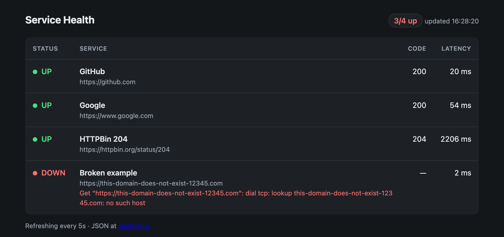

# HTTP Health Checker


**Uptime monitoring for your HTTP services, in a single Go binary.**

Give it a list of URLs and it checks them all at once, prints a status table,
serves a live dashboard, and sends **Slack alerts** when a service goes down or
recovers. Useful as a cron job, a CI gate, or a small always-on monitor for
internal services.



In the terminal:

```
STATUS  NAME            CODE  LATENCY  DETAILS
UP      GitHub          200   627ms
UP      Google          200   111ms
UP      HTTPBin 204     204   1.68s
DOWN    Broken example  -     51ms     dial tcp: lookup this-domain-does-not-exist-12345.com: no such host
3/4 services up
```

## Features

- Concurrent checks using goroutines — 50 services take about as long as the slowest one
- Simple YAML config with per-service method, expected status code and timeout
- **Run-once mode** exits with code `1` if anything is down, so it works in cron jobs and CI pipelines
- **Watch mode** re-checks on an interval
- **Live web dashboard** with a JSON API, served by the same binary
- Slack webhook alerts on state changes only (no spam while a service stays down)
- Graceful shutdown on Ctrl+C
- No dependencies besides `gopkg.in/yaml.v3`

## Install

Requires Go 1.22+.

```bash
go install github.com/sarahhghazali/healthcheck@latest
```

Or build from source:

```bash
git clone https://github.com/sarahhghazali/healthcheck.git
cd healthcheck
go build -o healthcheck .
```

## Usage

```bash
# Check once and exit
./healthcheck -config services.yaml

# Re-check every 30 seconds
./healthcheck -config services.yaml -interval 30s

# Send Slack alerts
export HEALTHCHECK_WEBHOOK_URL="https://hooks.slack.com/services/..."
./healthcheck -interval 30s

# Serve the dashboard at http://localhost:8080
./healthcheck -interval 10s -web :8080
```

| Flag        | Default         | Description                                                    |
|-------------|-----------------|----------------------------------------------------------------|
| `-config`   | `services.yaml` | Path to the config file                                        |
| `-interval` | `0`             | How often to re-check (e.g. `30s`, `5m`). `0` runs once        |
| `-webhook`  | `$HEALTHCHECK_WEBHOOK_URL` | Slack incoming webhook URL for alerts               |
| `-web`      | *(off)*         | Serve the dashboard on this address, e.g. `:8080`              |

## Web dashboard

```bash
./healthcheck -interval 10s -web :8080
```

Open <http://localhost:8080>. The page shows every service with its status,
response code and latency, refreshes itself on the check interval, and follows
your system's light or dark theme. If `-web` is used without `-interval`, the
tool checks every 30s.

| Route          | Purpose                                                              |
|----------------|----------------------------------------------------------------------|
| `/`            | The dashboard page                                                   |
| `/api/status`  | JSON status; returns `503` when any service is down                  |
| `/healthz`     | Liveness probe for the checker process itself                        |

The HTML page is compiled into the binary with `//go:embed`, so deployment is
still a single file with nothing to copy alongside it.

## Docker

The image uses a multi-stage build on top of
[distroless](https://github.com/GoogleContainerTools/distroless), runs as a
non-root user, and is only a few MB.

```bash
# Build the image
docker build -t healthcheck .

# Run with the built-in example config (re-checks every 30s)
docker run --rm healthcheck

# Use your own config file and check once
docker run --rm -v "$(pwd)/my-services.yaml:/app/services.yaml:ro" \
  healthcheck -config /app/services.yaml

# With Slack alerts
docker run --rm -e HEALTHCHECK_WEBHOOK_URL="https://hooks.slack.com/services/..." healthcheck

# Dashboard on http://localhost:8080
docker run --rm -p 8080:8080 healthcheck -interval 10s -web :8080
```

> Inside a container, `localhost` means the container itself. To check a
> service running on your machine, use `http://host.docker.internal:<port>`.

## Configuration

```yaml
services:
  - name: Payments API                 # optional, defaults to the URL
    url: https://api.example.com/health # required
    method: GET                         # optional, default GET
    expected_status: 200                # optional, default 200
    timeout: 3s                         # optional, default 5s
```

## Project structure

```
.
├── main.go                  # CLI flags, run-once / watch loop, alerting
├── services.yaml            # Example config
└── internal/
    ├── config/              # Load, default and validate the YAML config
    ├── checker/             # HTTP checks, run concurrently
    ├── notify/              # Slack webhook notifier
    ├── report/              # Terminal table output
    └── web/                 # Dashboard + JSON API (HTML embedded in the binary)
```

## Development

```bash
go test ./...     # run tests
go vet ./...      # static checks
gofmt -w .        # format code
```

CI runs formatting, vet, build and tests (with the race detector) on every push,
then builds the Docker image and runs it as a smoke test.

## Ideas for next steps

- Prometheus `/metrics` endpoint
- History and uptime percentages on the dashboard
- Microsoft Teams / email notifiers
- Retry a failed check before marking a service down
- Publish the Docker image to GitHub Container Registry
